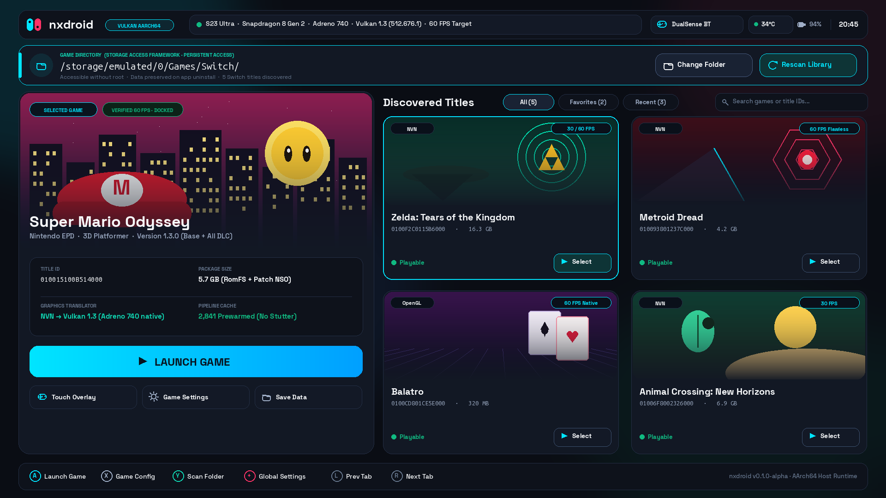
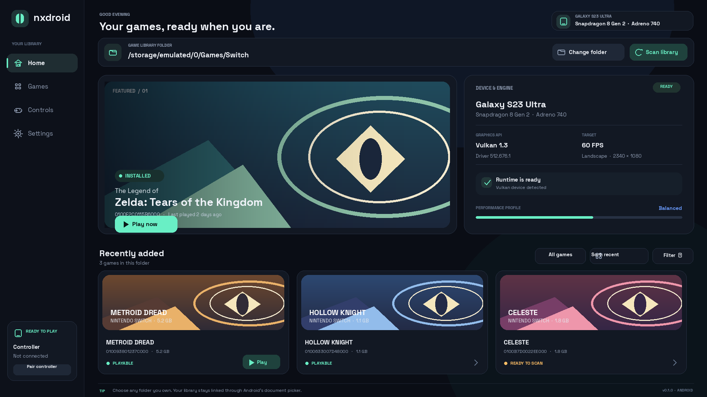
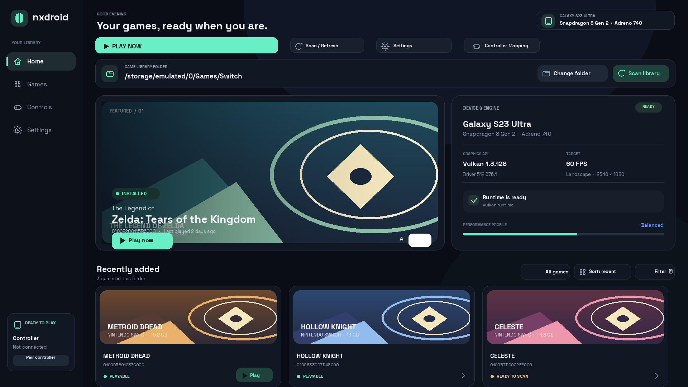

# Propostas de Interface (Welcome/Home Screen) para o nxdroid

Este documento apresenta as **três propostas visuais e conceituais de interface** solicitadas para substituir a tela preta inicial do `nxdroid` no **Samsung Galaxy S23 Ultra** (Adreno 740, landscape 1920x1080).

Todas as propostas atendem ao requisito fundamental: **permitir que o usuário aponte sua própria pasta de jogos (via Storage Access Framework - SAF)**, eliminando o caminho rígido em `/sdcard/Android/data/` (que é inacessível sem PC/root e é apagado ao desinstalar o app).

---

## 1. Proposta Gemini 4 Argon (Agente Especialista Android UI/UX)

- **Arquivo de Imagem:** [`mockup_argon.png`](mockup_argon.png)
- **Especificação Técnica Completa:** [`design_spec_argon.md`](design_spec_argon.md)
- **Script Gerador:** [`render_argon.py`](render_argon.py)

### Destaques do Design Argon:
1. **Estrutura Dual-Pane Estilo Console de Nova Geração (SteamOS / Switch OLED):**
   - **Painel Esquerdo (Hero Card):** Destaque cinemático do jogo selecionado (*Super Mario Odyssey*), com ilustração conceitual, estatísticas de pipeline (ex: *2.841 shaders prewarmed*), tamanho, tradutor gráfico ativo (`NVN → Vulkan 1.3`), e botão gigante de alta proeminência com gradiente Neon Cyan `[ ▶ LAUNCH GAME ]`.
   - **Painel Direito (Grid 2x2):** Lista de jogos descobertos (*Zelda TotK*, *Metroid Dread*, *Balatro*, *Animal Crossing*), com badges de API, framerate alvo (60 FPS / 30 FPS) e indicador de status verde (*Playable*).
2. **Barra de Diretório de Jogos (SAF) em Destaque:**
   - Exibe o caminho ativo: `/storage/emulated/0/Games/Switch/`
   - Botões diretos `[ 📁 Change Folder ]` (acionando `ACTION_OPEN_DOCUMENT_TREE` com `takePersistableUriPermission`) e `[ 🔄 Rescan Library ]`.
   - Rótulo explícito indicando que o diretório não é apagado na desinstalação.
3. **Barra Superior de Diagnóstico do Hardware:**
   - Logo Joy-Con bi-partido (Neon Cyan / Neon Crimson).
   - Chip de hardware: `S23 Ultra · Snapdragon 8 Gen 2 · Adreno 740 · Vulkan 1.3 (512.676.1) · 60 FPS Target`.
   - Telemetria de bateria, temperatura do SoC (`34°C`) e controle conectado (`🎮 DualSense BT`).
4. **Rodapé com Guia de Controle Físico:**
   - Mapeamento direto de botões: `(A) Iniciar`, `(X) Configurações`, `(Y) Varrer Pasta`, `(+) Menu Global`.

---

## 2. Proposta Codex (OpenAI)

- **Arquivo de Imagem:** [`mockup_codex.png`](mockup_codex.png)
- **Script Gerador:** [`render_mockup.py`](render_mockup.py)

### Destaques do Design Codex:
1. **Layout Dashboard com Trilho de Navegação Lateral (Nav Rail):**
   - Barra lateral fixa à esquerda com ícones para *Home*, *Jogos*, *Controles* e *Configurações*, mantendo o centro de tela limpo.
2. **Barra Horizontal de Diretório Personalizado:**
   - Exibe `/storage/emulated/0/Games/Switch/` com ações `[ Change folder ]` e `[ Scan library ]`.
3. **Painel Central Dividido:**
   - Banner de destaque do jogo com botão de ação direta `[ Play now ]`.
   - Card dedicado para **Device & Engine Status** à direita com informações de Vulkan 1.3, Driver 512.676.1, Perfil de Desempenho (*Balanced*) e indicador de runtime pronto.
4. **Carrossel Horizontal de Jogos Recentes:**
   - Linha inferior com cards de jogos compactos indicando Title ID, tamanho e status de compatibilidade.

---

## 3. Proposta OpenCode

- **Arquivo de Imagem:** [`mockup_opencode.png`](mockup_opencode.png)

### Destaques do Design OpenCode:
1. **Foco em Tipografia Space Grotesk e Acentos em Tons de Menta:**
   - Visual minimalista com tema escuro profundo e linhas estruturadas.
2. **Trilho Lateral Compacto e Área de Biblioteca Expandida:**
   - Prioriza a exibição da grade de jogos e atalhos rápidos para filtros e ordenação (*Sort: recent*, *Filter*).
3. **Card de Diagnóstico Integrado:**
   - Mantém as métricas de Vulkan e Adreno 740 em destaque no painel direito superior.

---

## Comparativo Direto

| Aspecto | Proposta Argon (Gemini Pro) | Proposta Codex (OpenAI) | Proposta OpenCode |
|---|---|---|---|
| **Inspiração Principal** | Switch OLED + Steam Deck UI | Dashboard Gamer Moderno | Handheld Minimalista |
| **Navegação** | Abas Superiores + Grid + Hero Pane | Barra Lateral (Nav Rail) | Barra Lateral Compacta |
| **Seletor de Pasta (SAF)** | Barra destacada com borda Cyan e persistência explícita | Barra horizontal no topo da área principal | Barra horizontal no topo da área principal |
| **Detalhes do Jogo** | Foco profundo (Shader prewarm, Vulkan layer, DLCs, Saves) | Foco rápido (Banner + Play now) | Foco rápido (Banner + Play now) |
| **Integração de Controle** | Dicas de botões físicos Nintendo `(A)(B)(X)(Y)` no rodapé | Indicador de controle na barra lateral | Indicador de controle na barra lateral |
| **Transição p/ Jogo** | Fade-out 250ms do Overlay sobre o `GameSurfaceView` | Troca de View / Fragment | Troca de View / Fragment |

---

## Recomendações de Próximos Passos (Quando for implementar)

1. **Escolha da Proposta Visual:** Avaliar qual dos estilos melhor atende à identidade visual desejada para o `nxdroid`.
2. **Implementação da Camada de View:**
   - Manter o `GameSurfaceView` no fundo (`Z-Index 0`) do layout root (`FrameLayout`).
   - Adicionar o `LauncherOverlayView` (`Z-Index 1`), evitando recriar o contexto Vulkan ao alternar entre menu e jogo.
3. **Persistência SAF:**
   - Implementar `ACTION_OPEN_DOCUMENT_TREE` com `takePersistableUriPermission` para permitir qualquer pasta indicada pelo usuário.
