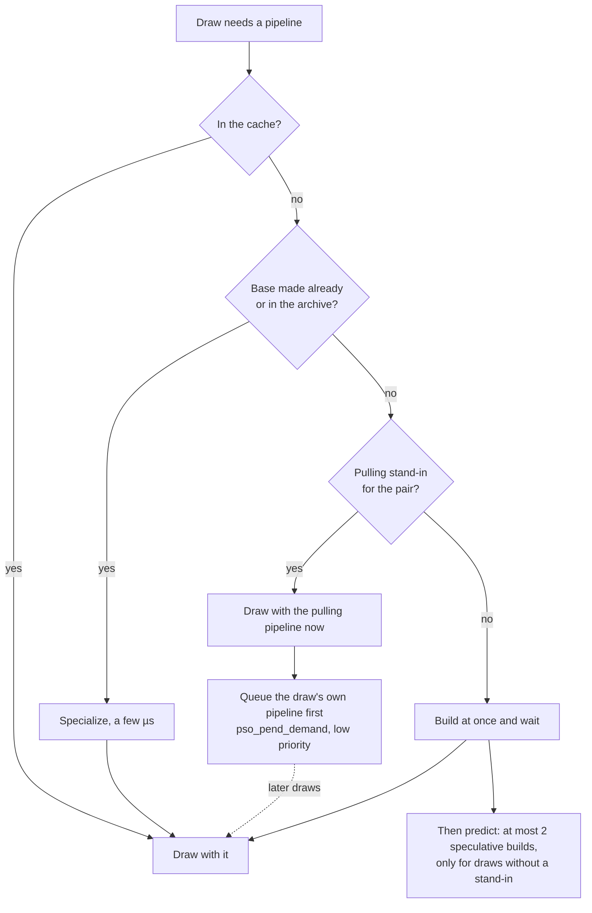

# Development

The README covers packing and playing. This page is for working on nxdroid itself: how it is built, the scripts' options, preparing games for Android, and adding a game (per-game notes are in [dm/games](../dm/games/README.md#games)). Agent-oriented details (bring-up failure catalogue, graphics specifics, debugging recipes) are in [docs/agents](agents/README.md).

## How it works

| Part | State |
|---|---|
| Rewriter (`dm/tools/patch_nso.py`) | Runs unchanged on every module of every supported game. Per-build cuts are keyed by the module's build ID, in the profile's `patches.py` (a game's own modules) or `dm/tools/sdk_patches.py` (Nintendo's `sdk` modules). Profiles can opt verified cuts into [function matching](reference/rewriter.md#function-matched-cuts-for-unregistered-builds) across updates |
| Host (`dm/host`) | Stands in for the Horizon kernel and the system services the games call: threads and synchronization, memory, file system with transactional saves, HID, audio, movies (VP9 through libvpx, Vorbis sound through stb_vorbis), software keyboard, focus and lifecycle |
| Graphics (`dm/gfx`) | NVN on Metal. Shaders are extracted by `shader_split.py` from Nintendo's containers and from Unity's `Shader` objects, then translated offline. Mario: 16,266 of 16,268 shaders compile. Engage: 9,268 of 9,269. Games that render with Vulkan (Hades) or OpenGL (Digimon Story Cyber Sleuth) go through layers of their own on Metal (`dm/gfx/vk`, `dm/gfx/gl`). On Android the vendored Vulkan engine replays the same NVN records ([Android](reference/android.md)) |
| Audio | Games that carry the SDK's audio renderer (Mario) run it in-process; games that use AudioOut directly (Engage: Wwise) feed it straight. On Android the output plays through AAudio (`dm/android/apple_stubs.c`), and `jni_android.c` sets `DM_AUDIO=1` by default |
| Input | The front end hands the host each player's buttons and sticks and the touches (`dm_input.h`; on Android `jni_android.c` calls `dm_pad_set_player`, `dm_pad_players`, `dm_input_set` and `dm_touch_set` for the app). Scripted input for tests is `DM_KEYS=<seconds>:<button>,…` (`hle_hid.c`). Players go up to 8 (`pad_slots.h`). Player 1 is the Handheld npad in handheld mode and No1 docked, player n is No n; the game's supported npad ids decide how many play (`hle_hid.c`): a one-player game gets every controller as player 1, and a controller past a game's last player is not used. Motion: a source drives its player's six-axis sensor through `dm_motion_set` (`hle_hid.c`; orientation with tilt correction toward gravity, `motion_fusion.h`). Without live motion the sensor lies flat. `DM_MOTION_LOG=1` logs player 1's mapped sample once a second per source; `DM_MOTION_AXES` (e.g. `x,-z,y`) remaps a source whose axes differ, `DM_MOTION_GAIN` sets the tilt correction (0.5), `DM_MOTION=0` turns motion off. The console's own sensor (`SevenSixAxisSensor`, read in handheld mode) still reports no states. In handheld mode the touches also drive `hid::GetGestureStates` (taps, presses, pans, swipes, pinches and rotations recognized by the host, `hle_touch.c`) |
| Known gaps | Conditional render is always drawn; `MultiDraw*IndirectCount` waits on the CPU for the GPU-written count; geometry shaders do not translate. TBDR optimizations are off by default (they don't understand bindless textures yet). No amiibo. The bundled prewarm lists are empty |

## Guest memory SVCs

`dm/host/hle_svc.c` serializes heap resizing, physical map/unmap, stack
map/unmap and memory queries with one memory-state lock. The alias bitmap is
the source of committed/free runs for `QueryMemory` and of committed-byte
accounting. With `mem_map_limit`, heap growth and physical maps check the same
application-pool budget; overlapping maps charge only newly committed pages.
Unexpected host protection failures abort before publishing state, including
the `SetHeapSize` fail-fast check from PR #127.

`MapMemory` borrows opened heap memory, committed alias memory or writable
static-module data until an exact unmap copies it back. Another borrow,
decommit, heap shrink or permission/attribute request cannot invalidate that
source. Queries report its original state with borrowed attribute bit 0 and
no user permissions. The implementation still copies bytes: source permissions
are logical, and native host pages cannot isolate adjacent 4 KiB slices.
Dynamic NRO backing is rejected because reload can restore it outside this
ownership lifetime. Host-created guest threads allocate their stack backing
through SDK malloc and free it after SDK thread destruction/copyback. Physical
recommit may overlap a borrowed source: SDK allocators extend committed windows
this way, and existing committed bytes are preserved.

A host-page exposure bitmap preserves lazy zero-fill on first commitment.
Later commits clear only newly committed logical slices, preserving live
neighbors on a 16 KiB host page. GPU dirty tracking is notified when a mapping
opens a host page and before stack copyback. The SDK retains address-region
reservation ownership and its existing build patches.

`make -C dm/host/tests GAME=<id> run` includes the production-dispatcher memory
tests, real GPU dirty-tracker integration and heap-probe log compatibility.
The focused targets are `heap_size`, `memory`, `memory-dirty`, `memory-profile`
and `memory-tsan`; `memory` includes undefined-behavior and address sanitizers.
The heap-probe check imports the production profile reader and needs only the
Python standard library; LZ4 is loaded when decoding NSO files.

## Continuous integration

`.github/workflows/tests.yml` runs on GitHub's Linux runners (`ubuntu-24.04`) on every
push to `main` and every pull request. `android-gates` is the gate list of `HANDOFF.md`
§5 and must stay green: the vendored engine's provenance (`android_vendor.py --check`),
the opcode and ABI vocabularies (`opcode_map.py --check` with `CC=gcc`,
`abi_gaps.py --check`), the portability audit (`android_audit.py --check`), the
symptom index (`docs_symptoms.py --check`), the engine's source checks under
`dm/gfx/vulkan/engine/tests` (text checks, no compile), and the tool tests for docs,
provenance, audit, thread slots, `undef_scan`, JNI, `dm_vm_alias`, the launcher
settings and the probe's output contract. `android-build` installs the NDK the Gradle
build names and compiles `dmhost` and `libdm.so` for one profile (arm64-v8a, API 29);
it must stay green too. Nothing runs on a device or a GPU.

The Mac host, iOS app and Metal jobs nxnative ran on the `xcode-27` image are gone
with the Android-only decision. Their tests stay in the tree with the Apple sources
until those are removed (`HANDOFF.md` §8 item 10): `dm/host/tests`, `dm/gfx/tests`,
`dm/gfx/tex/tests` and `dm/ios/tests` build with the Apple toolchain, and the
sanitizer exceptions in `dm/sanitizers/` belong to those builds.

`.github/workflows/lint-python.yml` lints `scripts/` and the Python tools under
`dm/` with ruff (rules for bugs, never reformatting) and type-checks them with
pyright in basic mode (`pyproject.toml`). It is a ratchet: today's findings are
in `dm/tools/lint_python_baseline.tsv`, so it fails only on a new finding, or on
a fixed one still listed there. Astral's ty, a faster type checker, can replace
pyright once it is stable. With the pinned tools in a new venv:

```sh
python3 -m venv /path/to/lint-venv && /path/to/lint-venv/bin/pip install -r .github/requirements/lint.txt
/path/to/lint-venv/bin/python3 dm/tools/lint_python.py            # the check CI runs
/path/to/lint-venv/bin/python3 dm/tools/lint_python.py --update   # after fixing findings: shrink the baseline
```

The baseline never gains entries: fix a new finding, or silence it on its line
(`# noqa: <rule>`, `# pyright: ignore[<rule>]`) with a reason. Only a raised tool
version in `.github/requirements/lint.txt` rewrites it (`--rebaseline`). On pull
requests, only the checker whose pinned release version increased may gain
baseline entries or counts. Comments, dependency updates and checker downgrades
do not allow growth.

`dm/tools/android_audit.py` is the portability gate for the Android port: it
scans the C, Objective-C and assembly of `dm/host` and `dm/gfx/nvn`, the code
that has to build on POSIX/bionic, for what only Apple has (Mach and Darwin libc
APIs, Objective-C frameworks, a 16 KiB host page, Mach-O sections). Its findings
are in `dm/tools/android_audit_baseline.tsv`, keyed by file, category and the
normalised line; the check fails on a hit that is not in the baseline and on a
baseline row whose hit is gone, so the record only shrinks
([Android](reference/android.md#the-portability-audit)).

```sh
python3 dm/tools/android_audit.py --check             # the check CI runs
python3 dm/tools/android_audit.py --summary           # hits per category, the files with most
python3 dm/tools/android_audit.py --all --summary     # the report's view: metal and vk too
python3 dm/tools/android_audit.py --write-baseline    # after a dependency is ported away, or added with its reason
```

`scripts/bug_report.py` (`-h`) collects the logs, versions and settings a bug report needs into one zip ([CONTRIBUTING.md](../CONTRIBUTING.md#reporting-a-problem)); it reads an allow-list of text files only.
The collector's checkout and chain are labeled separately. The 4 MB file limit and 20 MB bundle limit include `report.md` and truncation markers; space for the report is reserved before logs are collected. Explicit `.keys` inputs are refused.

`.github/workflows/fuzz.yml` fuzzes the Python parsers of files a player
supplies, nightly and by hand (never on pull requests): the RomFS image reader
(`romfs.py`), the control data (`nacp.py`), the NSO loader, the shader
containers of `shader_split.py` (BNSH, BAHS, MSHD, SARC / Yaz0, GLSLC, SDF,
ARH1 and the others `scan_blob` recognizes) and the Unreal paks and shader
archives of `uepak.py`. Each harness, `dm/tools/fuzz/fuzz_<parser>.py`, builds
its seeds in code and mutates them for 60 s; nothing comes from a game. A
finding is an exception other than the parser's declared rejection (each
harness's docstring says which), a hang or an oversized allocation. Its input
goes into `dm/tools/fuzz/corpus/<parser>/`, and `dm/tools/tests/test_fuzz_corpus.py`
replays the corpus with the tool tests on every pull request; an open finding
has a row in `dm/tools/fuzz/known.tsv` (its signature, its issue) and replays as
an expected failure until the parser is fixed, when the row comes out. Locally,
`python3 dm/tools/fuzz/fuzz_romfs.py --time 300` runs a harness: with atheris
(`.github/requirements/fuzz.txt`, which ships Linux wheels; the workflow runs on
`ubuntu-24.04`) coverage-guided, without it on a blind random engine.

## The packing script in detail

Two scripts prepare a game. `scripts/prepare_game_android.py` (`-h` lists every option) makes the folder the Android app runs:

```
# extract a base NSP or XCI with hactool and prod.keys (an update beside it is found by its name, or given with -u),
# rewrite its modules with --target=android, pack romfs.img, copy the profile's tables and build the .xgs shader bundles
python3 scripts/prepare_game_android.py "<NSP folder>/<base>.nsp" -k <prod.keys> -o <output folder>

# an already extracted folder (exefs/, romfs/ or romfs.img, control/) instead of a package
python3 scripts/prepare_game_android.py <extracted folder> --title-id <title ID> -o <output folder>

# also build the APK for the profile, install it, and push the prepared folder over ADB
python3 scripts/prepare_game_android.py "<NSP folder>/<base>.nsp" -k <prod.keys> -o <output folder> --build-apk --install-apk --push --device <serial>
```

- Without `-o` the output is `./prepared_games/<name>` under the working directory; keep it outside this repository. The work folder is `<name>-work` beside the input.
- The rewrite runs `dm/tools/patch_nso.py <module> <out> <name> --target=android` on `main`, `sdk` and each `subsdk<n>`, and keeps each module's fixups table.
- When `dm/games/<title ID>/` exists, its `shader_map.tsv`, `pso_manifest.tsv`, `shader_facts.tsv`, `pso_pairs.tsv`, `shader_pairs.tsv`, `game.tsv`, `xbg_game.cfg` and `gfx-*` marker files are copied beside the modules (a default `xbg_game.cfg` is written when there is none). The shaders are translated to SPIR-V by the translator's `dmsh_xlate.dll`, run with `dotnet` (or the `mcr.microsoft.com/dotnet/sdk:10.0-preview` image through podman or docker), and packed as `.xgs` bundles (XGS1); `--rebuild-shaders` builds them again.
- System data (MiiModel, `0100000000000802`) and saves (`userdata.dat`) are imported from an emulator NAND when one is found (`--nand` names it).
- `--build-apk` runs `gradle -p dm/android :app:assembleDebug -PdmGame=<title ID>` (or the same in the `dm-android-tools:1` image) into `dm/android/app/build/outputs/apk/debug/app-debug.apk`; `--install-apk` installs it with `adb install -r -d`; `--push` sends the folder as one tar to `--device-dir` (`/storage/emulated/0/nxdroid/game` by default) and the save into the `com.nxdroid` app's private storage. `--adb` names the adb binary, `--device` the device serial.

The rest of this section is the NSP script, `scripts/build_ipa_from_nsp.py` (`-h` lists every option), inherited from nxnative: it surveys a game without a profile, writes provisional and derived profiles, runs the run-time shader captures and the NVN shader chain whose tables the profiles keep. Its Apple outputs (the IPA, the Xcode project, Mac builds) are not part of nxdroid. For a game without a profile, `--survey-only` stops after the survey:

```
python3 scripts/build_ipa_from_nsp.py "<NSP folder>" -k <prod.keys> --survey-only
```

What the script does:
0. Before it extracts anything it checks the environment (`check_prereqs`): the Python modules and tools (glslang too, which an OpenGL game needs), the Metal compiler, and the shader translator, which it starts once with `--source-sha`, so a translator that finds no .NET 10 runtime of its architecture stops it here, not as an empty `xlate_source` at the shader step ([packing.md](reference/packing.md#the-shader-step-stops-with-an-empty-xlate_source)).
1. It finds the game profile from the title ID (the `[title ID]` in the file names, or the NSP's ticket; the update by its `[vN]` tag). The update is optional: it packs the newest version in the folder (`-p` / `PACKAGE` picks another).
2. It extracts ExeFS and streams the merged, integrity-checked RomFS directly into `<id>_build/extract/<version>/RomFS.img`. No RomFS folder or individual resource files are written. Shader scanners, profile discovery and NRO collection read bounded file ranges from that image through `dm/tools/romfs.py`; archive readers map only the archive's range. This requires Python 3.12 or newer. An old folder extraction is replaced atomically after the new extraction succeeds. Each DLC similarly becomes `aoc/<index>.img`.
3. It rewrites the code modules, checking each build ID against the profile. A version the profile does not register (the base game alone when the profile was brought up on an update, another update, or files whose build IDs differ), or one whose shader tables need a version that is not in the folder, is built from a profile derived from it in `<id>_build/profile/<id>/`: the profile's keys, that version's build row, and shader tables, chain header, `c1_full.tsv` and `cb_extent.tsv` made from that version's own files (as for a provisional profile, without the heap check; with the address region check below). The rewriter's cuts and the host's fixes for a registered build do not reach a module of another build; the script says which modules those are. A title ID no profile has is first looked up by build: when its `main` (of the base game with its newest update, else of the base game alone, read from a code-only extraction) is a build a profile registers, a regional release of the same build (Advance Wars 1+2: Re-Boot Camp under `0100300012FFF000`, issue #114), it packs from a profile derived from that one, with the folder's title ID and `main.npdm`'s program ID (`same_build`, `game.py` `by_build`); only otherwise is it surveyed. A provisional profile (a game without one in `dm/games`) then gets `mem_used` from the rewritten modules, and, when the game has virtual address memory and sets a heap, a heap check: the Mac host is built into `<id>_build/tools/dmhost` and the game boots in it until its first heap request (a few seconds, log `<id>_build/logs/heap_check.log`), which sizes the heap region (see [dm/games/README.md](../dm/games/README.md), Adding a game). For a game with virtual address memory, with a provisional or a derived profile, a second boot, the address region check, runs with a Switch-sized alias region for 15 s into `nnMain` (log `<id>_build/logs/region_check.log`, table `regions.tsv`) and reports the address regions the game takes, who asks for each and where they reach against the profile's alias region, in red when past it; when the regions made after a `StandardAllocator` region need more room than the host's cap leaves them, it sets `stdalloc_cap` in the profile ([memory.md, Measuring address regions and commits](reference/memory.md#measuring-address-regions-and-commits)). Both checks boot the game in the Mac host and have no Android equivalent yet.
4. For a game whose `main` holds GLSL sources and calls `glslcCompile` (Three Houses), it captures the shaders the game compiles at run time, which no game file holds. It builds the Mac host into `<id>_build/tools/dmhost` and boots the game in it, headless and silent, with `DM_GLSLC_CAPTURE` pointing at `<id>_build/extract/<version>/glslc_capture`. The save, temporary storage and log all stay in `<id>_build/`. It stops the game as soon as every capture file named in the profile's shader map is there (Three Houses: 9, about a second after launch), and gives up after 30 s. A folder that already holds them all is reused.
   A Vulkan game without SPIR-V files in its RomFS (Super Mario Galaxy) gets the same kind of run: the game boots in the Mac host with `DM_VK_CAPTURE` pointing at `<id>_build/extract/<version>/vk_capture` until every SPIR-V key in the profile's `vk_capture.tsv` is there (Galaxy: 3,089, about 7 s after launch), and gives up after 120 s.
   So does an OpenGL game with no GLSL source in its RomFS or `main` (Balatro: LÖVE puts its shaders together at run time, in Lua): `DM_GL_CAPTURE` at `<id>_build/extract/<version>/gl_capture` until every file in the profile's `gl_capture.tsv` is there (Balatro: 35, made before its first frame). Without the profile's tables (a provisional profile) a capture stops once nothing has been added for 20 s.
   The three captures run in the Mac host and have no Android equivalent yet. On a GPU without Metal 4 the Vulkan and GL layers draw on classic Metal queues of their own, so the NVN layer starts only its classic part and drops every present, which a headless capture does not need (`nvn_mtl.m` `mtl_device_classic`; `DM_TEST_NO_METAL4=1` forces it). The GLSLC capture boots an NVN game, which needs Metal 4.
5. It splits out the shaders from the game and every extracted DLC RomFS and checks them against the profile's tables (a Vulkan profile: it translates the RomFS's SPIR-V and the capture with `vk_shaders.py` instead; an OpenGL one: the GLSL sources and the capture with `gl_shaders.py`). Optional DLC that changes only the NVN shader union gets new tables in an external profile after the non-DLC shaders and facts have matched; registered module builds and fixes stay in use.
6. It builds the shader libraries with the in-repo SPIRV-Cross (`dm/gfx/tools/spirv_cross_bin`) and the Metal compiler in `dmsh_chain.lock`. This step needs the Apple-built translator and Metal compiler and has no Android equivalent yet (Android's `.xgs` bundles come from `prepare_game_android.py`, above). Another Metal compiler stops an NVN game's build before its shader steps. Issue #242 reported corruption with an untested compiler; its role remains unconfirmed. `--allow-other-metal` (`DM_ALLOW_OTHER_METAL=1` for `own_compilers.py`) permits it and reports the actual version. If a registered profile's `dmsh_chain.h` does not hold the version the source tree gives (a chain change left it behind), the script writes it again before any host is built, so it shows as changed in the checkout (`dmsh_build.py` would stop otherwise). Then the script makes the profile's `c1_full.tsv` and `cb_extent.tsv` from this build's Mac outputs when they are missing or name another chain. These two tables are not committed and git ignores them. Each line in the output names the file.
   It then compares the build with the game's previous one, the newest other `b-*/` in `<id>_build/shader/cache/` (`dm/gfx/tools/shader_regressions.py`, which reads the two `_b_build.json` reports). The translation chain is one for every game, so a translator change is tested only on the games its author owns; shaders that translated before and fail now are listed in `logs/shader_regressions.log` and stop the build ([GitHub issue #272](https://github.com/seedds/nxnative/issues/272)). Report them; `--allow-shader-regressions` goes on without them.

A repeat build skips work whose inputs have not changed. The extraction is kept (`extract/`). The DLC, the rewrite, the shader split and the shader libraries (an NVN, Vulkan or GL game's) each write a key beside their output: a sha256 of their inputs (the game files, the tools, the profile, Xcode's version and the in-repo spirv-cross; for the DLC, the DLC NSPs' names, sizes and times and nx_extract's sources). When the key matches, the stage line says `reused (inputs unchanged)` and the step does not run. Any change to a tool or the profile runs the step again; deleting the `.key` file forces it. The rewrite's key covers the patch files that name one of the modules' builds, the selected game's own, and always `dm/tools/sdk_patches.py`, whose SDK-wide `MATCH_CUTS` apply to builds it does not name (a new reviewed implementation was left out of a reused rewrite of Pokémon Legends: Arceus before). The shader libraries' inputs are the shader package's content and only the tools `dmsh_build.py` loads (the modules it imports, at any depth): a split that runs again because a reader for another engine changed (a pull that touches `shader_split.py` or `unityfs.py`) writes the same package, and the libraries stay reused.

Derived profiles keep generated files while `<id>.derived.key` matches and every source-generated data row remains intact, including repeated rows. Provisional and derived shader keys include their profile files and each RomFS or capture file's path, size and modification time. Re-extraction or a new capture timestamp therefore runs the split or Vulkan/GL translation again, even with identical bytes. Registered RomFS keys use paths and sizes; NVN split tables are still checked against the profile.

The rewrite also collects NRO modules registered by the game's NRR files, including modules inside supported archives (`nro_collect.py`). The host maps the rewritten modules at startup and activates them on `nn::ro::LoadModule`, with symbol precedence following activation order; unloading and reloading restores their initial data and bss. `DM_NRO=0` disables this loading. Epic Online Services modules are identified by their exports and refused, preserving offline play. Collection reuse includes the archive reader and symbol parser; the rewrite key includes `nro.tsv`, even when it lists only refused modules. The synthetic loader test (`make -C dm/host/tests GAME=<id> nro`) covers load order, rebinding, weak symbols, init/fini, data reset and refusal without game files.

While it runs, the console shows one line per stage: building nx_extract, extracting each version, the DLC, the rewrite, the run-time shader capture (only for such profiles), the shader split and the shader libraries. Each line shows `[k/n]`, the stage and its current step. Where the work can be counted, it adds a bar with done/total, percent, elapsed time and ETA. Counted work is bytes extracted, modules rewritten and shaders (cache check, translation, compile). Elsewhere a spinner shows the elapsed time. A total marked `~` is an estimate. A version's first extraction is estimated from the NSPs' size, and later extractions use the previous run's exact size. In a terminal the line is redrawn in place. When the stage ends, it becomes a `✓` line with the elapsed time and a summary:

```
[15:24:28] ✓ [2/7] extract v327680 (0:20): 9,779 files, 5.0 GB
```

When the output goes to a file or a pipe, the script prints a plain line instead, every `BEAT` seconds (30). `--progress bar|lines|off` overrides that choice; `off` prints only each stage's start and end. The tools' own output goes only to the logs in `<id>_build/logs/`, one per step. When a step fails, the script prints the last 40 lines of that step's log and the log's path.

`--progress json` is for a program that shows the build (a GUI): stdout carries one JSON object per line, each with `ev` and the time `t`. The events are `stage` (`k`, `n`, `name`, `step`), `step`, `progress` (`done`, `total`, `unit`, `est`, `note`, `frac`, `eta`, `elapsed`; `null` while unknown), `stage_end` (`ok`, `summary`, `elapsed`) and `say` (`msg`: every message, errors and a failed step's log tail included). A count change goes out at most every 0.5 s, any other change at once. This mode never asks for the NSP folder or the keys; argument errors and an unexpected error's traceback still go to stderr. `dm/tools/tests/test_nsp_progress.py` tests it without game files or keys (`python3 -m unittest discover -s dm/tools/tests`).

A file in the NSP folder counts only when its header is an NSP's or an XCI's (whatever its name says); others are skipped with a line. The NSP folder may be on an exFAT or FAT drive: the AppleDouble `._<name>` files macOS writes there are skipped quietly, and removing a folder tolerates entries that vanish meanwhile ([exFAT drives](reference/packing.md#a-game-folder-on-an-exfat-drive-reads-one-update-as-two-or-fails-to-remove-a-folder)). Everything it writes stays in the NSP folder: intermediate files and logs in `<id>_build/`. NSZ and XCZ files are converted with `nsz -D` (from the `nsz` package in the Python running the script, else an nsz 5.0 or later executable on PATH, `nsz` or the release binary `nsz-cli-macos-arm64`, given the keys with `--keys`) into `<title ID>_build/nsp/`, through a temporary folder so that only a conversion nsz finished is used, and reused while the source keeps its name, size and modification time; `nsz -D` reports an NCA hash mismatch but goes on, so a damaged file is caught by nx_extract's own hash check (`--allow-damaged`). The keys selected by `-k` are linked temporarily as `keys.txt` for nsz's import-time lookup ([NSZ keys](reference/packing.md#nsz-decompression-rejects---keys)). The extracted game files stay in `<id>_build/extract/` for the next build; `--no-keep-extracted` deletes them at the end. It exits with 0 when done and 1 on an error.
The game language (`--language`; English by default) is what `nn::oe::GetDesiredLanguage` returns. As on the console, it must be one the game's control data lists (`SupportedLanguageFlag`, `nacp.py --languages`); the packed version's control data counts, since an update may add languages. The same language for another region stands in (`en-GB` for `en-US`, `es` for `es-419`, `fr` for `fr-CA`, `pt` for `pt-BR`, and back). A language the game lacks stops the build with the game's list; English, the default, falls back to the game's first language.

On Android, the Vulkan engine reads marker files `gfx-<switch>` in the game folder (a first character of 0 turns the switch off, anything else on, and a marker wins over the environment the app sets); `scripts/android_gfx_ab.py` writes or removes one over adb, restarts the app and can save a screenshot and the log, so one switch is compared without a rebuild.

Game rumble is enabled by default (`DM_RUMBLE=0` disables it); `DM_RUMBLE_GAIN=0..3` scales its strength (default 1, zero is silent). Both are launcher settings, independent of `DM_TOUCH_HAPTICS`. `DM_RUMBLE_LOG=1` logs the game's vibration handle requests and, once a second, the values it sent, how many had no routed output and the peak amplitude. `hle_hid.c` decodes SDK vibration handles (style index / npad / motor bytes, as in libnx's `_hidGetVibrationDeviceHandles`) and routes them through the same player assignments as input. `hle_haptics.c` retains each motor's two amplitude/frequency bands, commits batches atomically and invalidates queued output on lifecycle or route changes. The output is a sink the front end installs (`dm_haptics_init`); the only sink is the Apple front ends' Core Haptics one (`haptics_apple.m`), and the Android front end installs none yet. `DM_RUMBLE_MIN=0..0.9` (default 0) silences controller levels below it, for games whose quiet texture keeps rotating motors running. A connected controller without haptics produces no game rumble. Continuous effects keep running until the game stops them; short effects are not extended. Engine resets, focus loss and interruptions clear the old values and require a fresh game signal. `make -C dm/host/tests GAME=<id> run` covers state and HID routing without hardware.

### GPU measurement

These switches of the Metal replay layer (`nvn_mtl.m`) split a frame's GPU time by pass, and are off by default: `DM_NVN_GPUPROF=every:<n>` (each encoder's GPU time and attachment traffic in one frame of every n), `DM_NVN_PASSDUMP=every:<n>`, `DM_AB=<frames>` (switches set to `ab` alternate in phases of one run) and `DM_GPU_CAPTURE` (Metal GPU traces, written to `DM_GPU_CAPTURE_DIR`, by default `gpu_captures/` in the working directory, which keeps the newest `DM_GPU_CAPTURE_KEEP`). `dm/tools/gpuprof.py` reads their log lines. How to use them: [05, GPU time on the device](agents/05-debugging.md#gpu-time-on-the-device). The Vulkan engine on Android has switches of its own ([The app's graphics defaults](reference/android.md#the-apps-graphics-defaults)), compared one at a time with `scripts/android_gfx_ab.py`.

### Frame capture and replay

`DM_NVN_CAPTURE=<frame>:1:<path>` (an NVN game, Mac host) writes one frame to one file, at the boundary between recording and replay: from the frame's first `nvnQueueSubmitCommands` to its present (frames counted as `DM_NVN_SHOT` counts them). `dm/gfx/tests/nvn_replay` replays it against the replay layer of the tree it is built from (`nvn_mtl.m` and everything under it) and compares the presented frame with the live one. Capture and replay run in the Mac host against the Metal replay layer and have no Android equivalent yet.

```sh
DM_NVN_CAPTURE=900:1:<NSP folder>/<id>-work/capture/frame900.nvncap DM_DETCLOCK=16666667 DM_PSO_HYBRID=0 … dm/host/dmhost <modules>
make -C dm/gfx/tests GAME=<id> nvn_replay
dm/gfx/tests/nvn_replay <NSP folder>/<id>-work/capture/frame900.nvncap --repeat 8
```

A capture is game data: it stays in the game's work folder, never in the repository or a report (digests and timings may go there). The file (format in `dm/gfx/nvn/nvn_capture.h`) holds a header (chain, host commit, profile, `main` build ID, frame, every `DM_*` setting of the run), the record layout it was made with, every live pool's bytes, the texture and sampler registries, each program's stage keys and a fingerprint of the bindings its translated shaders had, the contents of every texture the frame can reach whose content lives only in Metal (render targets, copy destinations), each submission's records, and the presented frame's digest and pixels. Pointers in the records are written as a region and offset (an address in a pool, or in memory a record reads outside the pools, such as deferred texture handles) or as an object index (textures, programs, descriptor pools, syncs, other segments); `cap_rec_fields` in `nvn_capture.c` names every such field, and static asserts there break the build when a payload struct in `nvn_obj.h` changes. Before each later submit of the frame it adds the pool blocks that changed and the registry entries that changed. Each capture step first waits for the GPU, which changes the frame's timing but not its content; unset, the hooks in `hle_nvn.c` cost a call and a branch per submit and present.

The replayer is built like the gfx tests: it includes `nvn_mtl.m` and `hle_nvn.c` in its own translation unit, so it needs no entry point in them. It applies the live run's `DM_*` settings (one given on its command line wins), so it takes the same shader map and libraries (`DM_NVN_SHMAP`, `DM_MSL_DIR`, the current chain's `b-<chain>`), maps the regions at fresh addresses, rebuilds the objects and registries, fills the captured textures, decodes the records and hands them to `mtl_exec` submit by submit, then reads the presented texture back the way the capture did and prints its SHA-256 next to the live one, with the submissions' CPU time and the frame's GPU time; when they differ, it also prints how many pixels differ from the live frame, the largest difference of one byte and the box around them (a capture made before the live pixels were stored is compared by digest only). `--repeat n` replays the frame n times, each in a fresh process (replay against replay); `--warm n` replays it n times in one process, each after the one before, which also replays against the replay layer's own state from the run before (pipelines built meanwhile, caches), so those replays may differ from the first. A replay of an unchanged tree is not always the live frame bit for bit: on Breath of the Wild up to about 120 pixels differ from run to run (its note, Open; the cause is open). So measure a capture's noise first, with `--repeat 8` on the tree the capture was made with, then check a change with `--max-pixels n` set just above the worst of those replays: a replay that differs in at most n pixels counts as a match. Exit status 0: the same frame (within `--max-pixels`); 1: different; 2: it stops with a `[RED]` line because the capture is another game's, was made with another record layout, a program's translated shaders now take other bindings or inputs than the records were made for, or the file is damaged.

Tests without game files: `t_capture` (CPU only, in CI) runs synthetic records through the format and the relocation; `make -C dm/gfx/tests GAME=<id> check_t_capture_live` (GPU) captures the second of two synthetic frames and replays it with `nvn_replay`.

Diagnostics: each replay writes the presented image beside the capture (`.replay<n>.png`, the live one is `.live.png`); the first replay takes the live frame's number, so `DM_NVN_TEXDUMP=<that frame>:<path>` given to the live run and `--texdump <dir>` (every replay's colour targets) compare the frame target by target; after each replay the replayer compares every pool block with the live run's state after the frame and names the ops of the records that touch blocks that differ; `--writes` lists, per submission, the pool ranges the GPU writes and the later records that read them; `--made` lists the textures the frame made without captured content. Under `MTL_SHADER_VALIDATION=1` (and `MTL_SHADER_VALIDATION_REPORT_TO_STDERR=1`) a replay reports the undefined reads of the replay layer, such as a texture that is not resident, with where Metal made the texture.

What step 1 does not cover yet (GitHub issue #402): a replay that equals the live frame bit for bit every time (above); more than one frame (pool deltas between frames); multisampled textures and formats that are not plain texels are not captured (a `[RED]` line at capture); sparse virtual pools; addresses stored inside pool contents (the game's own pointers to GPU memory) are not relocated; textures the CPU uploads through `DM_GAME_TEX_DIRTY_UPLOAD`'s flush tracking are uploaded again from the pools in the replay; timing and synchronization (waits, the encode thread, present pacing) are not reproduced.

## Port another game

Each game has a profile in `dm/games/<id>/`:
- `game.tsv` holds the title ID, known builds, code modules, RomFS marker, memory split, app name and bundle ID;
- the shader tables: `shader_map.tsv`, `shader_facts.tsv`, `shader_pairs.tsv`, `pso_pairs.tsv` (pairs used by vertex output padding and the pipeline prebuild), `pso_manifest.tsv`, and `c1_full.tsv` / `cb_extent.tsv`, which each checkout's full shader build makes (not committed);
- `patches.py` (when there are any): the rewriter's patches of the game's own builds.

The shader translation chain has one version for every game, in `dm/gfx/nvn/dmsh_chain.h`. What the shader libraries and the host must agree on, the NVN driver segment layout and the binding kinds of the reflection, is written once in `dm/gfx/nvn/dmsh_abi.h`: the host includes it, the build reads it through `dm/gfx/tools/dmsh_abi.py`, and `dm/tools/tests/test_dmsh_abi.py` guards it ([Shaders, Bindings and handles](reference/shaders.md#bindings-and-handles)).

The shader tools pick a profile with `DM_GAME=<id>`; `make -C dm/host` picks it with `GAME=<id>`, the Android CMake build with `-DGAME=<id>`, and `prepare_game_android.py --build-apk` with `-PdmGame=<id>`. Profiles are named after the base game's title ID. There is no default game: without `GAME` / `DM_GAME` the tools stop and list the profiles. `python3 dm/games/game.py list` lists the profiles. Host code that relies on one build's fixed addresses checks that build's ID.

A setting in `dm/games/settings.tsv` can require a verified rewrite capability (`fixups:<NAME>`). A game's `patches.py` declares `CAPABILITIES = {build ID: (name, ...)}`; the rewriter writes those flags only for that main build. This keeps controls that require particular rewritten instructions out of older or unsupported builds. For example, NieR's resolution control requires its native scale/UV path and configurable preset bounds.

To add a game:
1. Run `scripts/build_ipa_from_nsp.py` on its NSP folder. With no matching profile, it writes a survey to `<title ID>_survey/survey.md`. The survey covers the modules, SDK, engine, containers, rewrite sites, and the imports compared with the host's hooks. It then writes a provisional profile into `<title ID>_build/profile/<title ID>/` (outside the repository; tools find it through `DM_GAMES_DIR`) with the keys `dm/games/profile_guess.py` reads off the game files: the graphics API, the modules to load, where the shaders come from, the memory partition, SDK and engine presets. After the rewrite it sets `mem_used` from the rewritten modules and, for a game with virtual address memory that sets a heap, boots it in the Mac host until its heap request (the heap check, a few seconds) to size the heap region. A game with virtual address memory also gets the address region check, which says whether its reservations fit the profile's alias region and who makes those that do not. Both boots need the Mac host and have no Android equivalent yet. Then it generates the shader tables and chain header. `--survey-only` stops after the survey, `--no-heap-check` skips the heap check and the region check, and `--profile-out` puts the profile elsewhere. `--provisional` does all this for a game that has a profile, to test the guesses; `python3 dm/games/profile_guess.py --check` compares the static guesses with every profile. Details in [dm/games/README.md](../dm/games/README.md).
2. Add a profile as described in [dm/games/README.md](../dm/games/README.md).
3. Prepare it for the device with `scripts/prepare_game_android.py` ([The packing script in detail](#the-packing-script-in-detail)), which copies the profile's tables.
4. Bring the game up following [docs/agents](agents/README.md): extraction, binary survey, a catalogue of host bring-up failures, graphics, and debugging recipes.

## Build by hand

The steps by hand follow; the host build is the one in [HANDOFF.md §5](../HANDOFF.md#5-gates-and-the-exact-commands). The shader translator is the prebuilt `dm/gfx/tools/dmsh_xlate_bin`, the build that matches `dmsh_chain.lock`; a fresh `dotnet publish` gives different fingerprints. spirv-cross is the prebuilt `dm/gfx/tools/spirv_cross_bin/spirv-cross`, not the one on `PATH`: `build.sh` beside it builds it reproducibly from a pinned SPIRV-Cross commit, with SPIRV-Cross's licences beside it; every shader tool (the NVN chain, `vk_shaders.py`, `gl_shaders.py`) runs it, and the lock records its fingerprint ([GitHub issue #242](https://github.com/seedds/nxnative/issues/242)). The translator's launcher `dmsh_xlate` and spirv-cross are Mach-O binaries, so step 3 currently needs them and the Metal compiler and has no Android equivalent yet; `prepare_game_android.py` runs the same translator's `dmsh_xlate.dll` through `dotnet` for its SPIR-V instead. The commands use three variables:
- `G`, the profile;
- `W`, the game's work folder: `<title ID>-work` inside the game's NSP folder, outside this repository and off the home folder (it grows to the size of the game files);
- `VER`, a version folder named after the NSP version.

```
G=010015100B514000; W="<NSP folder>/$G-work"; VER=v327680
# 1. extract: the base game alone (update -), or an update layered over it, directly into an image
dotnet build dm/tools/nx_extract -c Release -o $W/build/nx_extract
$W/build/nx_extract/nx_extract <prod.keys> <base NSP> - $W/data/v0 --romfs-image
$W/build/nx_extract/nx_extract <prod.keys> <base NSP> <update NSP> $W/data/$VER --romfs-image
# 2. rewrite the profile's code modules for Android (the Android loader refuses the default, Apple, output)
for m in $(python3 dm/games/game.py $G modules); do python3 dm/tools/patch_nso.py $W/data/$VER/ExeFS/$m $W/build/patched_$VER $m --target=android; done
# 3. the NVN shader chain (Apple-built tools): extract from every version in the profile's shader_versions (comma-separated, base first), then translate into <cache>/b-<chain version>/
DM_GAME=$G python3 dm/gfx/tools/shader_split.py $W/data/v0/RomFS.img,$W/data/$VER/RomFS.img $W/data/v0/ExeFS/main,$W/data/$VER/ExeFS/main $W/shader/pkg dm/games/$G/shader_map.tsv dm/games/$G/shader_facts.tsv dm/games/$G/shader_pairs.tsv
DM_GAME=$G python3 dm/gfx/tools/dmsh_build.py $W/shader/pkg $W/build/cache/metal_shader_cache   # also writes dm/games/$G/c1_full.tsv and cb_extent.tsv
# 4. the Android host for the profile, with NDK r29 in the toolchain image (HANDOFF.md §5: ANDROID_PLATFORM 29 or later, arm64-v8a only)
podman run --rm --userns=keep-id -v "$PWD:/src:rw" -w /src dm-android-tools:1 \
    cmake -S dm/android -B build/android/$G -DGAME=$G -DANDROID_ABI=arm64-v8a -DANDROID_PLATFORM=29 \
      -DCMAKE_TOOLCHAIN_FILE=/opt/android-sdk/ndk/29.0.14206865/build/cmake/android.toolchain.cmake
podman run --rm --userns=keep-id -v "$PWD:/src:rw" -w /src dm-android-tools:1 cmake --build build/android/$G --target dmhost
# 5. the APK for the profile, installed on the connected device
gradle -p dm/android :app:assembleDebug -PdmGame=$G
adb install -r -d dm/android/app/build/outputs/apk/debug/app-debug.apk
```

Notes on these steps:
- `dmsh_build.py` stops when a tool differs from `dm/gfx/tools/dmsh_chain.lock`. To try another Metal compiler, run `DM_ALLOW_OTHER_METAL=1 dm/gfx/tools/own_compilers.py` with the same arguments and environment. It reports the actual compiler and keeps its cached libraries separate from the tested compiler's; the translator and SPIRV-Cross must still match.
- After a chain change, `python3 dm/gfx/tools/shader_regressions.py $W/build/cache/metal_shader_cache` lists the shaders that translated in the previous `b-*/` there and fail in the current one (exit status 1), as the NSP script does after its shader step.
- `dmsh_build.py` compiles each shader's Metal source through a cache keyed by that source, the compile flags and the compiler (`dm/gfx/tools/dmsh_mtlcache.py`, in `<cache>/cas/metallib/`). A chain change that leaves a shader's MSL unchanged costs that shader no Metal compile while the cache format and compiler stay unchanged. Before building, the cache takes libraries from earlier `b-*/` folders beside its output (and beside `IOSOUT`), and from `DMSH_PREFILL=<Mac root>[=<iOS root>]` (several separated by `:`). Every imported library must record the current flags and compiler identity in its reflection; unmarked legacy libraries are rebuilt. A fresh compile of two shaders per stage also checks their bytes. The summary line `Metal cache:` shows reused, compiled and filled counts per target.
- Each shader's cache key (`shader_key`) includes `CODE_FP`, a hash of the *code form* (`dmsh_chain.code_form`: the AST, with docstrings and the rule functions' bodies removed) of `dmsh_build.py` and its helper modules. An edit that cannot change the output (a comment, a docstring, blank lines, formatting) keeps every shader's key, so the next build restores them all instead of translating them again; any change to code, a constant, a string literal or a default argument still rebuilds all of them. The chain version is not touched by this: it still hashes whole files.
- hactool cannot read every update (Mario 1.2.1's patch NCA gives "Invalid BKTR layout!"), which is why `nx_extract` uses LibHac. Note that `prepare_game_android.py` extracts packages with hactool.

## Prewarm lists

Metal compiles each combination of shaders and pipeline settings for the GPU the first time it is used. Each takes tens of milliseconds, so a burst of them on entering a level is a visible freeze. The host records what it had to compile and rebuilds those pipelines on a background queue at the next launch:

- `pso_user.tsv` sits next to the save directory, in the parent of `DM_SAVE` (`DM_PSO_USER=path` overrides it). It is appended while playing, one line per item built on the spot: a shader (`S`), a render pipeline (`R`, the hex of `pso_skey` in `dm/gfx/nvn/nvn_pso_skey.h`) or a compute pipeline (`C`).
- `dm/games/<id>/pso_manifest.tsv` is the seed list bundled with the app, prewarmed before `pso_user.tsv`.

The lines name shaders by content key and hold no compiled code and nothing personal, so a list recorded on one device works on any other. To seed the bundled list:
1. Record with prewarm off, so everything is built on demand: `DM_PSO_MANIFEST=off DM_PSO_RECORD=<file>`, playing the scenes players reach first. Engage's list covers boot, the opening movie, the title, a save load and the prologue battle.
2. Append the recorded lines below the header comments, in the recorded order. Duplicates are dropped at load, and so are shaders the shader map does not have (a list of another version of the game: the bundled list packed with a version the profile was not brought up on, or a device's `pso_user.tsv` kept across a game update), which the `prewarm done` line counts.
3. Prepare the game again: `prepare_game_android.py` copies the profile's `pso_manifest.tsv` into the game folder.

Record on the game version you ship. At launch the log names each list it read and its line count (`pipeline prewarm list …: N lines`), or says that `pso_user.tsv` does not exist yet.

During rendering, a pipeline miss compiles and caches the demanded pipeline before scanning subsequent draws for speculative work. The scan admits at most two new jobs, with at most two speculative compilations outstanding; completed predictions remain available by exact key. This limit does not apply to the startup warmer. `t_pso_pending` checks scheduling and ownership with a gated compiler; it does not establish that the two-job budget is optimal on every device or remove the cost of compiling an unseen pipeline.

### The prepare step

With a window, the game waits for the prewarm before its first frame: the first submission (`mtl_sub_begin`) runs every line of both lists and goes on only when the shaders are loaded and the pipelines built (`warm_prepare` in `dm/gfx/nvn/nvn_mtl.m`). The workers are as many as the device has cores (`hw.activecpu`; `DM_PSO_PREPARE_THREADS=<n>`), at user-initiated QoS, since the game draws nothing meanwhile. Each task is a shader, a compute pipeline, or all render pipelines of one shader pair, which share their bases, so no two workers compile the same base. A vertex shader's pulling entry is loaded with it, so neither a listed draw nor its hybrid stand-in loads a library on the submit thread; the shaders and pipelines go into the caches the draws use, which keep them for the whole run. The step runs at the first submission and not before the game starts because the vertex entry each pipeline is built with follows the depth mode the game sets (`nvnDeviceSetDepthMode`).

It runs at every start. When the Metal shader cache and the pipeline archive hold everything it takes well under a second, and the front end shows its screen only past 0.5 s, and only when the rate so far leaves 0.3 s or more to go (no screen that flashes up and goes): a dark view over the game's with "Preparing shaders", a progress bar and a count (`front_progress` in `front_mac.m` and `front_ios.m`). A stamp saying that the step ran would skip it exactly when the system has dropped the Metal cache (an OS update, or storage pressure), which is when it is needed. The log has `pipeline prepare: N lines (… shaders, … render pipelines, … compute pipelines) in … s on N workers before the first frame, progress screen shown / not shown; bases … compiled, … from the archive, … reused`. Without a window, or with `DM_PSO_PREPARE=0`, the prewarm runs in the background on one worker, as before; `DM_PSO_PREPARE=1` makes a windowless run wait too.

The step covers what the lists name: a first start as far as the profile's `pso_manifest.tsv` covers the route (record it as above, over the scenes a new player reaches first and a save load), every later start through `pso_user.tsv`. A shader or pipeline no list names yet is built when first drawn, served meanwhile by the hybrid pipelines below. It is NVN only: the Vulkan and GL layers keep no prewarm lists (Hades creates its pipelines itself while it loads, 1,856 before its first frame).

The compiles scale with the workers only about three to seven times over one, since the Metal compiler service is shared. Breath of the Wild's starts with and without its seed list and the step: [its note](../dm/games/01007EF00011E000/README.md#pipelines-on-a-cold-start).

### Pipeline bases and the pipeline archive

Concurrent requests for the same base share its in-progress build and result; unrelated bases can compile in parallel. Rasterizing pipelines without a fragment function use the `MTLDevice` path so depth-only draws keep their depth writes: Metal 4 requires a fragment function when rasterization is enabled. Transform-feedback pipelines, whose rasterization is disabled, can still use Metal 4.

Render pipelines are built through Metal 4's `MTL4Compiler` (`pso_build` in `dm/gfx/nvn/nvn_mtl.m`). `pso_desc` still describes each pipeline; from it the host builds a *base* whose colour attachments (format, blending, write mask) are left unspecialized, once per base, and makes every pipeline from its base by specialization, which takes a few microseconds instead of the 3–5 ms of a pipeline build. Metal 4 pipelines name no depth or stencil format, so one base serves every depth/stencil attachment. Live keys and historical prewarm rows share [normalization of unused colour state](reference/shaders.md#pipeline-keys-omit-unused-colour-state), and the warmer deduplicates parsed keys before compiling.

The bases are kept in a per-game pipeline archive in `pso_archive/` beside `pso_user.tsv`. Each file holds what one flush captured (`NNNNN.mtl4a`). A flush runs after the prewarm and 10 s after a burst of new bases. At start the host opens every file, and a base found in one is taken from it directly, in about 0.06 ms where building it takes 10–80 ms. Only bases no file holds are compiled, so each file holds new bases only. The serializer must capture binaries only: with descriptor capture as well, it writes no archive and reports no error. A compile must not end while its serializer writes (that crashes Metal), so each flush period has its own compiler and serializer: a flush gives the compiles after it a new period and writes the old one once its compiles have returned, so no compile waits for a flush ([A compile that does not return stalls every flush and draw](reference/shaders.md#a-compile-that-does-not-return-stalls-every-flush-and-draw)).

Every start adds a file or more: Breath of the Wild wrote 5–7 per start, and each file a base is not in costs a lookup about 0.06 ms. With more than 8 files (`PSO_ARCH_COMPACT`) the archive is compacted: the bases the prewarm takes from the old files are captured again through the compiler from their original shader functions, without lookup archives; the flush after the prewarm writes them into one file, and the old files are removed (`arch_compact_finish`). Bases the prewarm did not take (no `pso_user.tsv` line names them) go with the old files and are built again when drawn. The log says `pipeline archive compacted: N files gave M bases …`. Importing bases through lookup archives could crash Metal during serialization ([issue #342](reference/shaders.md#a-compaction-flush-that-crashes-then-crashes-every-start)); capturing the original functions avoids that framework defect, at the cost of more compiler work on a compaction start.

The log shows `pipeline archive …: N files, … MB, opened in … ms` at start, `pipeline archive: N new pipeline bases written to …` after each flush, and after the prewarm a line counting the bases compiled, taken from the archive and reused. `DM_PSO_ARCHIVE=off` turns the archive off; `DM_PSO_ARCHIVE=<folder>` puts it elsewhere. `DM_PSO_MTL4=0` builds every pipeline through the `MTLDevice` as before, with no bases and no archive. The Metal 4 path, with the hybrid pipelines and the prebuild, is on by default in the Mac host; in the iOS app it is on for a game whose profile sets `pso_mtl4 on` or with `DM_PSO_MTL4=1`, and off otherwise. For such a game the bases can be made offline and shipped with the app ([The pipeline archive made offline](#the-pipeline-archive-made-offline)); the device builds them itself only as a fallback. Pipelines whose functions have no Metal 4 descriptor (the diagnostic `DM_NVN_HILITE` and `DM_NVN_MAGSCAN` overrides) always take the `MTLDevice` path.

During compaction, timed flushes defer while prewarm runs. Once it finishes, one archive-queue task flushes the recaptured bases and removes the old files. The pending count and serializer capture are protected by the same compile/flush lock, so a flush consumes the count for the bases it writes.

### Hybrid pipelines

A draw whose pipeline is not built yet no longer waits for the Metal compiler when a stand-in exists (`hybrid_get`, `pso_get_` in `dm/gfx/nvn/nvn_mtl.m`). On a miss the draw first takes its pipeline without compiling: its base made already or in the archive, then a specialization. Failing that, it draws with the shader pair's *pulling* pipeline (the `<key>_bp` vertex entry, [pulling vertex inputs](reference/rendering.md#pulling-vertex-inputs)). That pipeline has no vertex descriptor and reads the draw's streams through a per-draw layout block (`pull_bind`), specialized with the draw's colour state. Meanwhile the pipeline for the draw's own vertex layout is built in the background, and a later draw takes it when it is ready. Both compute the same positions (`t_pull_inv.m`), so a draw that switches between them does not flicker or z-fight. Merged passes, readable-tile and diagnostic fragments, and layer-writing or transform feedback vertex shaders have no stand-in and wait as before. A pulling stand-in is used only when its base is already made or in the archive. Otherwise the base is built in the background for the pair's next miss, and the draw waits. `DM_PSO_HYBRID=0` turns the hybrid off. It needs the Metal 4 path, so it follows that path's defaults above (the profile key `pso_mtl4 on` or `DM_PSO_MTL4=1` turns both on).

The hybrid keeps the demand-first order above (PR #75). A draw that gets a stand-in queues its own pipeline first (`pso_pend_demand`), before the prediction runs. Such demanded builds are outside the speculative limit and go to serial queues at utility QoS, one per two performance cores (`pp_bg_queue`), so they never wait behind speculation and speculation never waits behind them. The prediction's budget of two speculative builds goes only to draws that will have no stand-in, because those would wait. A draw that would wait for a build still queued makes the pipeline itself at once, instead of waiting behind the queue (`pso_pend_take`). When the table is full, the oldest finished entry no draw took is reclaimed, as for the speculative builds. The first pipeline miss of a submission also loads, in parallel, the shader libraries the rest of the submission binds (`shader_prefetch_rest`). For the frame that entered Zora's Domain in Breath of the Wild that was 248 libraries in about 210 ms, where loading them one by one on the submit thread took about 1 s.

The path of a draw whose pipeline is not in the cache:



Every 300 frames the log has a `pipelines up to frame` line. It gives the submit thread's pipeline, library and prediction time; archive lookups that found the base or none; specializations and base compiles on all threads; draws with a hybrid pipeline; background builds; and the draws that waited, by why no stand-in served them. `DM_PSO_WAITLOG=1` logs every wait over 20 ms with its shader pair. `DM_PSO_PULL_ALL=1` (diagnostic) draws every draw that has a pulling pipeline with it. In steady state the GPU time is the same with and without the hybrid: in Breath of the Wild, mean GPU p50 over frames 2,400–5,100 was 8.98 ms with it, 8.98 ms on the Metal 4 path without it, and 9.35 ms through the `MTLDevice`.

The **prebuild** puts the pulling base of every known shader pair into the archive (`pso_prebuild`), so a cold start's draws have stand-ins. The pairs come from the profile's `shader_pairs.tsv` and `pso_pairs.tsv`. `shader_pairs.tsv` pairs the stages of one BNSH variation (and the other readers' programs). It held none of the pairs from agl's BAHS shader archives (`.sharcb`, the agl / gsys / terrain resource packs), and in Breath of the Wild 109 of the 543 pairs drawn on entering Zora's Domain came from those. `shader_split.py` now reads the binary and program arrays of a BAHS file (`bahs_variations`) and pairs the n-th vertex binary of a program with its n-th fragment binary. Those pairs go to `pso_pairs.tsv`. The shader build reads both tables to pad every vertex output its pixel partners need ([reference](reference/shaders.md#pixel-shader-inputs-the-vertex-shader-does-not-write)); the pairs also control build order and cache dependencies. The profile's `pso_pairs.tsv` is part of its inputs digest. For Breath of the Wild that is 3,012 more pairs, and all 543 pairs drawn are now known. A profile made before the table existed still packs: the NSP script then keeps the table beside the shader package, where the shader build reads it, and hands it to the prebuild (`DM_PSO_PAIRS`). Super Mario Odyssey, Mario Bros. Wonder, Mario Kart 8 Deluxe, 3D World, Animal Crossing, Captain Toad and Tears of the Kingdom have BAHS files too; their tables are made at their next pack.

With the prepare step (a window) the prebuild runs right after it when the bases are not there yet, before the game's first frame, behind the same progress screen ("Preparing pipelines"), on every core, flushing every 1,000 bases; a first start waits for it once, until every pair is handed to a worker (the compiles still under way then finish in the background). Built in the background while playing instead, the compiler's load on the shared power budget raised Breath of the Wild's GPU time per frame. Without a prepare step it still runs in the background after the prewarm, on a utility queue on half the performance cores (`DM_PSO_PREBUILD=0` turns it off either way). It also runs as a tool, `DM_PSO_PREBUILD=tool`: build, write, exit. It runs once per chain version, depth mode and pair list (`pso_archive/prebuilt.tsv`: the pair lists' size and SHA-256). Pairs whose base failed to build are listed in `pso_archive/prebuild_failed.tsv` with the system build they failed on; a later start of that system build leaves them to the draws, another one tries them again. `DM_PSO_PREBUILD_DEPTH=zero` serves a game that sets the near=0 depth mode (the NSP script sets it from the profile key `depth_mode`); `DM_PSO_PREBUILD_THREADS=<n>` sets the workers. Its files hold bases without a vertex layout only, and are named `pNNNNN.mtl4a`; a base with a vertex layout is never looked up in them, and compaction leaves them alone. Breath of the Wild: 15,767 bases, 910 MB in 16 files; the host's footprint is about 850 MB larger with them open, which is one reason the Metal 4 path stays off in the iOS app unless a game's profile sets `pso_mtl4`. An archive made offline and shipped with the app (next section) comes first; the device's own prebuild is the fallback, for an app without a usable archive.

Breath of the Wild's cold starts with and without the prebuild and `pso_pairs.tsv`: [its note](../dm/games/01007EF00011E000/README.md#pipelines-on-a-cold-start).

### The pipeline archive made offline

The pipeline bases can be made offline and shipped in the app. Otherwise the device builds them on first start behind the "Preparing pipelines" screen; [Breath of the Wild's note](../dm/games/01007EF00011E000/README.md#pipelines-on-a-cold-start) records the build times, sizes and startup measurements. `dm/gfx/tools/pso_offline.py` makes them. It makes Metal archives with Apple's `metal-tt`, so this step needs Apple tooling and has no Android equivalent yet. Only the Metal 4 path reads them, so by default it does this for a game whose profile sets `pso_mtl4 on`, and for no other:
1. It writes a Metal 4 pipelines script (`metal4-pipelines-script(5)`) with the base of every pair in `shader_pairs.tsv` and `pso_pairs.tsv`, by the prebuild's rules (`pre_desc` in `nvn_mtl.m`): the pulling vertex library `<key>_bp` (a vertex shader without stage inputs: its own `<key>_b`), the vertex entry for the depth mode, the pixel shader's entry, no vertex descriptor, one sample, every colour attachment unspecialized. Pairs the prebuild leaves to the draws are left out the same way. A pair whose functions declare function constants is left to the device (`rest_pairs.tsv`): `metal-tt` makes no specialized function from a library ("cannot find private metadata"), and the host specializes such functions with an empty set. If every eligible pair needs this specialization, the tool writes the remainder list without running `metal-tt` or shipping an archive, and the device builds them all.
2. `metal-tt` compiles the script into one archive per GPU architecture: `xcrun -sdk iphoneos metal-tt -arch applegpu_g18p -ios-version-min 27.0 bases.mtl4-json -o applegpu_g18p.mtl4a`. The script needs the `.mtl4-json` extension, from which `metal-tt` takes the format: as `.mtlp-json` (Metal 3's format) it rejected even the Metal 4 serializer's own capture ("expecting [ instead got {"), which it compiles under the right extension. The archive refers to the libraries by content, not by path, so the app's own copies (`msl/b-<chain>`) find their bases.
3. The archives go into the app as `pso/` with `prebuilt.tsv`, the stamp the device's prebuild would write for the same chain version, depth mode and pair lists. With an archive, or for a game whose profile sets `pso_mtl4 on` (its hybrid pipelines draw with them), the app also carries the pulling libraries (`_bp`), which the bases are made of.

`main.m` hands `pso/` to the host as `DM_PSO_BUNDLE` (`off` ignores it). The host opens the file named after the device's GPU architecture (`MTLDevice.architecture`, e.g. `applegpu_g18p.mtl4a`) read only and looks it up first among the files of bases without a vertex layout (`pso_bundle_open`); it never writes or compacts it. Before the prebuild, `pso_bundle_covers` compares the bundled `prebuilt.tsv` with this run's stamp, then looks up the bases of 16 pairs spread over the list. Coverage needs at least one actual lookup and no misses; ineligible sampled pairs supply no evidence. If both hold, the device builds no base, only the pairs in `rest_pairs.tsv`; otherwise it runs its own prebuild as before, which still takes from the bundle every base it finds there. An archive for another GPU, one the system cannot open (made for a newer system, or an OS update changed the GPU compiler), a probe that finds nothing, or a stamp of another depth mode each give an info line (`pipeline archive bundled with the app: …`), not a red one. The on-device prebuild is the fallback: it runs when the app has no archive for the device's GPU, when the system cannot open the archive or take its bases (an iOS update that changed the GPU compiler, a system older than its minimum), or when its stamp is not this run's (another depth mode, other pairs). The device's own archive (`pso_archive/`) gets only what the bundle lacks: a draw, the prewarm and the prebuild compile a base, which the serializer then captures, only after the bundle missed it, and bases with a vertex layout, which the bundle never holds (`t_pso_bundle` checks a covered pair's draw: no compile, nothing captured). Metal crashed (`MTL4ArchiveImpl::loadFromURL`) when handed a file that was no archive, a text file or a bare Mach-O header, so `arch_file_ok` checks the Mach-O load commands and payload ranges, universal slice bounds and the serializer's bundled Metal library ranges before opening a file; this holds for the device's own files too. It checks the container structure; the compiler's private payload remains Metal's responsibility.

The settings:
- `DM_PSO_GPUS` (the NSP script's `--gpu`): the architectures, comma-separated, with or without the `applegpu_` prefix. Unset, it follows the profile: `g18p` for a game that sets `pso_mtl4 on`, and `none` for the others, whose app would carry an archive it never reads. Another device's name is its `MTLDevice.architecture`, which its log names when the app has no archive for it (`pipeline archive bundled with the app: none for this GPU (…)`). `none` builds no archive. Each architecture increases build time and app size; see the measurements in the game note linked above.
- `DM_PSO_IOS_MIN`: the archives' minimum iOS version. The default is the SDK's major version (`27.0` with the iOS 27 SDK); a device on an older system cannot open them and builds the bases itself.
- The profile key `depth_mode` (`gl`, the default, or `zero`) picks the vertex entry (`main0` or `main0_z`). The host learns the game's depth mode only when the game sets it, so the build cannot derive it. A wrong value costs only the device's own prebuild, as without the archive.

An archive is made again only when its inputs change: the consumed libraries' bytes and stamp (`inputs.tsv`), the stamp above, the architecture, the minimum OS, `metal-tt`'s version and `pso_offline.py` itself (keys in `$W/build/ios/pso/work`). A shader rebuild with another Metal compiler can change the library bytes without changing the profile or chain stamp, so the stamp alone is insufficient. Archive validation and fallback regressions are recorded under [Offline pipeline archive reuse and fallback](reference/shaders.md#offline-pipeline-archive-reuse-and-fallback).

## Power

The game's own work and its frame rate stay as they are; the host avoids work of its own that the Switch never did. Every 300 frames the log has a `power` line (CPU energy in watts and per frame, CPU time, wakeups, thermal state, the threads that yield most) and a `residency set` line; [05](agents/05-debugging.md) explains them.

- **Yield loops.** On the Switch, a yield with nothing else to run is free; a guest loop that polls the clock or a flag and yields is a busy spin on the host. Three Houses waited out each frame this way (228,000 yields a frame) until a per-build cut made its frame limiter sleep (see its notes). After 2 ms of consecutive yields with no other SVC, each yield sleeps an eighth of the wait so far, from 10 to 250 µs (`DM_YIELD_BACKOFF=0` turns it off, `=<cap µs>[:<start µs>]` sets the cap and the start). The back-off first started after 200 µs, which also caught Tears of the Kingdom's main thread waiting for its workers on the frame's critical path: frames ran past 33 ms and the game dropped itself to 20 fps. From 2 ms on it never backs off there. Not every yield loop waits, though: some yield between steps of work. A yield whose caller's callee-saved registers (x19–x28, which the SDK's `YieldThread` leaves as the loop had them) differ from the last yield's counts as progress: it returns at once with no host call, as a yield with no other thread to run does on the Switch, and the run starts again. A poll keeps its pointers and deadline in those registers; a loop that works moves its counters. Animal Crossing: New Horizons' `SaveProc` builds a new island in grid walks that yield once per cell: with the back-off the screen stayed black for 77 s after the opening movie, now about 10 s. Breath of the Wild's `PlacementMgr` and `RadarMgr` yield once per item of their batches (the back-off stretched a 94,263-item radar batch to about 30 s).
- **Spin loops.** A guest loop that polls memory with no SVC at all spins on a host core. On the Switch the spin fills only its own core, and a higher-priority thread pinned there preempts it. Paper Mario: The Thousand-Year Door's three job workers (`main+0xa8e680`) poll the job list this way while a batch is pending. The rewriter finds such loops in every module (`patch_nso.py`, "Spin waits"). A loop counts only when it provably cannot leave by itself:
  - every path from its head back to it runs only loads, register and flag arithmetic, direct branches and barriers (no store, call, SVC, system register or event wait);
  - nothing live at the head is written on the way (no counter, cursor or delay);
  - an exclusive add that every path back undoes on the same address is allowed (a worker that registers with a job, sees it finished and backs out);
  - so is a spin lock taken and released on the same address on every path back (an exclusive test-and-set retried until it stores, then an exclusive compare-and-clear or a store-release of zero), a test loop on a word inside the loop (load, compare with a constant, branch back to the load), and up to four stores whose value and address registers the loop never writes. Each such store writes a fixed value to a fixed address, so the words it writes can only hold their first value or a stored one: a loop like that changes its own state for a few hundred passes at most (a fraction of the gate's 2 ms of polling), then its passes repeat and only another thread can end it (a loop with such stores must also load something). A store of a value the pass changes ends its path, and the search runs again without it: a poll that takes its item once the wait is over stores the new cursor there;

  Such a pass leaves memory and registers as they were, so only another thread can end the loop, and a pause there changes only timing. The loop is copied into the patch area. Its original back-edges jump to the copy, so the first pass costs nothing, and the copy's back-edges go through a spin gate (`dm_spin_wait`). A wait polls on through the gate for its first 2 ms and then sleeps as a run of yields does (`DM_SPIN_POLL`, `DM_YIELD_BACKOFF`); `DM_SPIN=0` never sleeps there. The gate alone slows the poll down: most waits are handoffs between workers, so a `sched_yield` on every pass would cost frame time.

  Breath of the Wild's job queue (`main+0xef62dc`) needed the lock rule. The first item of some of its jobs is for the thread of core 0, and the threads of the other cores wait until it is taken (the queue's flag at +0x98, its cursor at +0x94), each taking and releasing the queue's lock (+0x1c) on every pass. The two workers (cores 1 and 2) polled at full speed, so the lock went back and forth between their cores, and the main thread (core 0), whose item it was, lost nearly every exclusive store to them: in 40 s of a Time Profiler trace it never once held the lock while the workers held it about 750 times each, and the three spun for 30–210 ms at a time, the CPU hitches in its notes below. Through the gate the workers leave the lock a moment between passes and the main thread takes its item at once. The search keeps every loop it found before and adds: Breath of the Wild's `main` 308 → 310 (this one, and a state setter at `main+0xf82230` that stores its state and returns on the second pass unless another thread changed it), its `subsdk0` one loop wider (`0x27804`, the movie library's thread loop, 6 → 23 instructions over the same back-edge and two more); Mario Kart 8 Deluxe's `main` 25 → 26 (a state setter like Breath of the Wild's, `main+0x715df8`) and its `subsdk0` one loop wider (the same movie library loop, `0x24118`). Of the 206 modules on the game drives (108 NSOs and Super Smash Bros. Ultimate's 98 NROs), 175 rewrite byte for byte as before (Hades, Super Smash Bros. Ultimate and Super Mario Odyssey among them) and 7 fail under both rewriters (every `rtld`, and New Super Mario Bros. U Deluxe, a 32-bit program); the other 24 take new loops, all through the store rule alone (only Breath of the Wild's job queue has a lock): Monster Hunter Rise's `main` 90 → 166 (72 of them one inlined countdown, `ldr w9,[x21,#0x24]; subs w9,w9,#1; b.ge; str w22,[x21,#0x24]; ldr; cbz`, whose reset makes the next pass leave), BALL x PIT 87 → 94, Animal Crossing: New Horizons 162 → 166, Balatro 9 → 12, Octopath Traveler 0 75 → 78, Pikmin 4 80 → 83, Bayonetta 3 35 → 37, and one more each in Big Brain Academy, Metroid Dread, Pokémon Legends: Z-A, Stardew Valley, Super Mario Bros. Wonder (both builds) and Tears of the Kingdom; the movie library loop is wider in the `subsdk0` of Animal Crossing, BALL x PIT, Monster Train 2 and Octopath Traveler 0 too, and one loop is wider in the `main` of AI: THE SOMNIUM FILES and of Advance Wars 1+2. No loop of the old search is lost or loses a back-edge. Each distinct shape was read in its disassembly: one-pass resets and state setters (the gate is reached only when another thread changes the word), parser states that leave on the next pass (Octopath Traveler 0 `main+0x4ebfa54`, Balatro `main+0x1f4600`), and real flag waits (Big Brain Academy `main+0x1734e0`, the movie library). Searching paths through stores costs time: Breath of the Wild's `main` takes 26 s of CPU to rewrite instead of 19, all 206 modules about 4,100 s instead of 3,250.

  Loops found: TTYD 17 in `main`, 5 in `sdk`, 8 in `subsdk0`; Wonder's `main` 175, Breath of the Wild's 308, Tears of the Kingdom's 843. In Tears of the Kingdom, 701 of them are one inlined atomic decrement (a compare-and-swap retried after another thread changed the count), which yields only on a second retry in a row. The x18 scan now decodes in blocks without details, so the rewrite takes less time than before even with the search: TTYD `main` 20.5 → 11.7 s of CPU, Tears of the Kingdom's 101.5 → 64.2 s, Monster Hunter Rise's 507 → 342 s.
- **Waits block instead of polling:** the in-process audio renderer, upload batches, `nvnQueueFinish`. A signalled event wakes only the threads waiting on it; leaving an SVC takes the global lock only while a pause (IL2CPP's garbage collector) is pending.
- **Real-time policy.** The thread that acquires the window texture declares a Mach time-constraint policy, which tells the performance controller the frame deadline. `DM_RT=0` leaves it on its QoS, for measuring.
- **Frame-step probes.** A game that waits out a longer hold (`nvn_fstep.h`, 30 fps after late frames) gets parked on the efficiency cores even though the declared period stays at 60 fps, and there its frames never fit 60 again. While under 30% of the process's CPU time runs on performance cores, in two windows of 30 presents in a row (thermal state nominal or fair, Low Power Mode off), the frame step therefore tries 60 again after its hold-off even when the cost does not fit. The first 30 frames of such a probe may be late, so the controller has time to raise the clock. A probe whose run at 60 then ends within 8 s counts as failed, so the next one waits twice as long (1 → 8 s). The GPU clock follows the hold too. A GPU time at the longer hold of at least 1.3 times its time at 60 fps that alone does not fit 60 (`nvn_fstep_gpu_slowed`; the reference is not updated during a probe) also allows probes, under the same gates. A hitch starts probes too. A step up after 8 s or more at 60 fps keeps what that run's frames cost (frames on time only), and a cost at the longer hold of at most 1.1 times it means the scene costs what it did (`nvn_fstep_same`; measured, so no thermal gate). The fit trial alone did not bring such a game back: the iPhone lowers its GPU clock until the work fills most of the frame, so a GPU-bound game's cost sits near the fit line (0.85 of a vsync) at either hold. A run under 8 s keeps no cost, so a device that steps up every few seconds stays at 30 rather than flap. Log: `frame step: hold 2 → 1 … (probe, CPU N% on performance cores)`, `(probe, GPU 1.70× its time at hold 1)` or `(probe, cost 1.04× the cost that held hold 1)`, `the probe held / failed`, and on a step up `hold 1 held at 0.86`. `DM_TEST_PRESENT_LAG=1,10;1200,30,3` imitates such a hitch.
- **Thread classes.** Every guest thread runs at QoS user-interactive, whatever its Switch priority. `DM_QOS_MAP=1` (off by default, for a phone A/B) maps priority ≤ 44 to user-interactive, 45–59 to user-initiated and the rest to utility (`DM_QOS_EDGES=44,59` moves the edges). `SetThreadPriority` moves a thread's class too, and a thread waiting on a lock lends its class to the owner until the lock is handed over. Host helper threads then set their own class (audio notify, silent sink and vsync user-interactive, movie decode user-initiated) instead of inheriting it from the guest thread that made them.
- **Replay CPU.** Memory-pool addresses are cached per thread; per-encoder draw state is sent only when it changes; texture IDs of GPU-only textures stay cached when the game writes other memory; upload staging blocks are reused (Breath of the Wild used to allocate, make resident and free a 32 MB block for each re-upload of a small CPU-written texture, about 3 GB/s) and the residency set is committed only when it changed.
- **Vertex bindings.** Normal and transform-feedback draws reuse resolved stream addresses until the guest address or memory-pool generation changes. The vertex argument table skips unchanged addresses, including slot 30's zero buffer; converted streams and shader-argument writes update the same table cache. `DM_NVN_VBUF_CACHE=0` restores repeated lookups and table writes for an A/B run. Every 300 frames, `vertex bindings` reports per-frame lookups/reuse and table writes/skips (the table counts include vertex shader arguments). Compare the existing submit CPU/instruction and onscreen interval logs as well: fewer binding calls alone do not establish a frame-rate gain. `t_vbuf` (`dm/gfx/tests`) is the Metal GPU-readback regression for both settings.
- **GPU.** An inline uniform update inside a render pass no longer ends the pass (Metroid Dread ended about 246 passes a frame this way, each one storing and reloading its attachments): the update lands when the pass ends, and the draws after it read a copy of the updated data (`DM_NVN_UB_DEFER=0` restores the old behaviour). When the update covers only part of what a draw's shader reads of the block, the rest of the copy comes from memory and the other inline updates queued in the submission, unless a copy, fill, storage write or an earlier submission still running may have written it (`DM_NVN_UB_PARTIAL=0` ends the pass instead; `DM_NVN_UBP_CHECK=1` checks every such copy against the GPU's memory). Clears with no draw after them no longer open a pass of their own when the game sets other targets: the next pass that attaches the same target clears it as its load action (`DM_NVN_LAZY_CLEAR=0` restores the old behaviour). A format-changing texture copy that covers the whole destination level does not load it first. `DM_NVN_BARRIER=game` lets a pass's vertex work overlap the previous pass ([04](agents/04-graphics.md) section 7); it is off by default, as the games issue their own barriers before most passes anyway.

## Game notes

Each game's notes are in its profile folder, `dm/games/<id>/README.md`: what the profile needs and why, what was found on the game and open items. The [games table](../dm/games/README.md#games) lists them.

## Tools (`dm/tools`)

| Tool | What it does |
|---|---|
| `nx_extract/` | NSP → ExeFS / RomFS image / icon with LibHac, merging an update over the base game (C#, `dotnet build`, `--romfs-image`). `--manifest` writes ExeFS and a RomFS file list only, for surveys; omitting both options retains legacy folder extraction |
| `nso.py` | The one loader of code modules (NSO and NRO), which every tool that reads a module's code uses: it checks a module as Horizon does (the loader's layout rules and segment hashes for an NSO, nn::ro's for an NRO), and against the file's size before allocating, so a damaged or truncated module stops the tool with a `[RED]` line. On its own, `nso.py <module> <out.bin>` writes the whole memory image (bss as a zero tail) |
| `nso_fnmap.py` | Carries offsets from one build to another (function matching with addresses masked; globals via their references) |
| `nso2elf.py` | Converts NSO to ELF for Ghidra / REA |
| `env_switches.py` | Writes [docs/env_switches.tsv](env_switches.tsv): every `DM_*` environment switch the code reads, with its class and a one-line meaning. The classes: player (a launcher setting, `dm/games/settings.tsv`), path (names a file or folder), switch (changes what the host or a tool does), diagnostic (logs, dumps, probes, measurements), test (read only by tests). It keeps the class and meaning of each row and adds a row for a new switch, whose meaning its author writes; `test_env_switches.py` fails until they do, and when a row names a switch nothing reads. It also lists the names the docs quote that nothing reads |
| `gpuprof.py` | Sums the host's `[gpuprof]` lines (`DM_NVN_GPUPROF`) by pass shape or size class, lists one frame's encoders in GPU order, and gives the medians of the `[ab]` phases (`DM_AB`) |
| `insn_census.py` | Counts the instruction sites the rewriter must handle |
| `nso_code.py` | Function ranges from `.eh_frame` and the data blocks in a text segment, which the rewriter and the census leave out |
| `nso_syms.py` | Compares the SDK import surface of two games, or of one game (`-` for the reference) with the host hooks |
| `nro_collect.py` | The NRO modules a game registers in its NRRs, found as loose files, among an indexed archive's current files (`data.arc`) or by a scan, written out for the rewriter with `nro.tsv`; online SDKs are listed as refused |
| `nvn_slots_got.py` | Builds the NVN fetch table and call sites (GOT-indirect loaders) |
| `loader_census.py` | Which of the functions a name loader fetches (glad's GL loader over `eglGetProcAddress`, NVN's C proc loader) the code really calls: the GOT slots or globals the loader stores, loaded by other code (followed through registers, relocated GOT entries and `csel`, for LÖVE's glad) |
