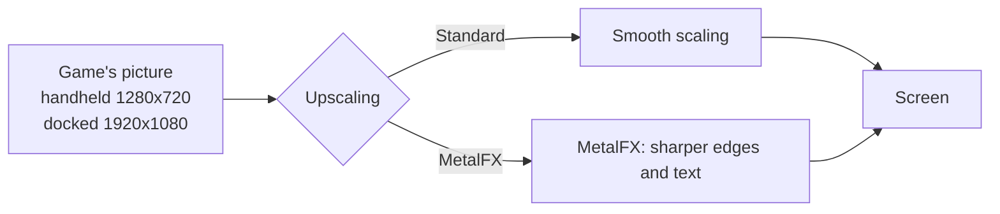
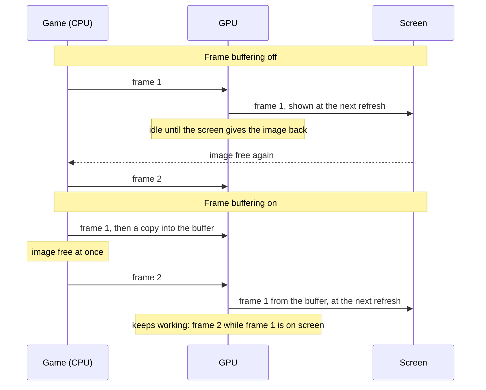
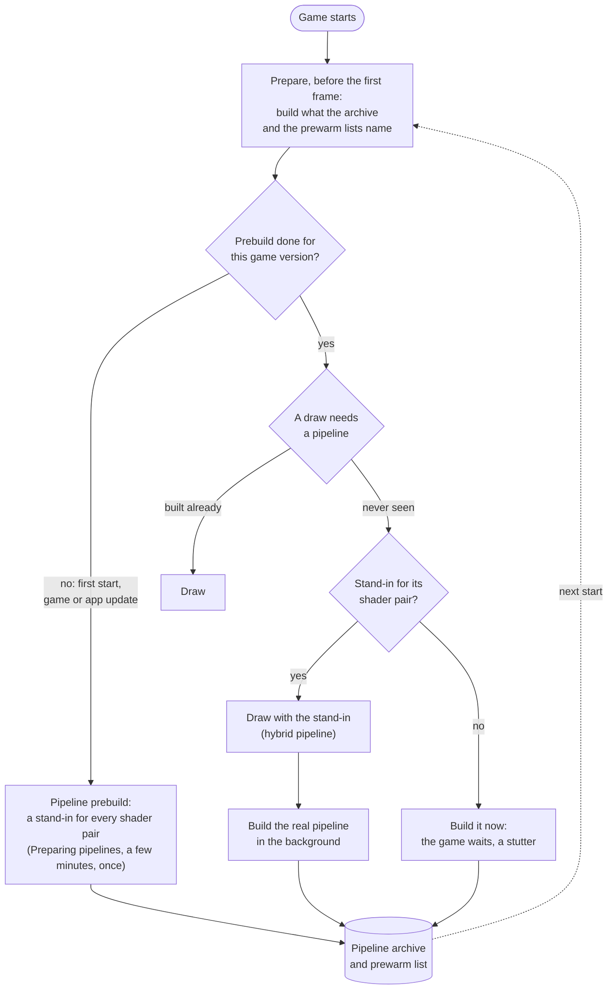
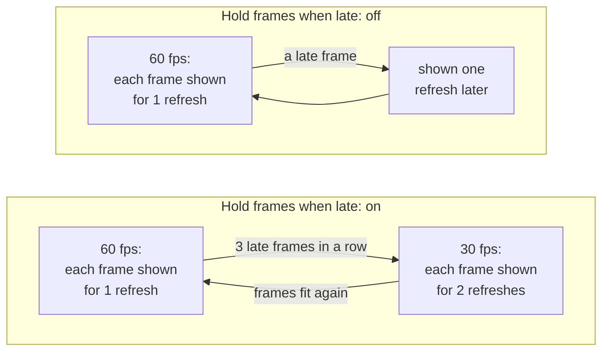

# Settings

The Android app has no settings screen yet and reads no settings file: it starts every game in console (docked) mode, with the defaults the app and the game's profile set (`dm/android/jni_android.c`). This page describes the settings each game's profile offers, as [dm/games/settings.tsv](../dm/games/settings.tsv) lists them ([The settings list](frontends.md#the-settings-list)), and what each one does in the host. Several belong to the Metal graphics layer (`dm/gfx/nvn/nvn_mtl.m`) or to the Apple haptics (`dm/host/haptics_apple.m`), which the Android build does not compile (`dm/android/CMakeLists.txt` drops every `.m` file); each of those says so.

- [Tested defaults](#tested-defaults)
- [Game](#game): [Frame rate](#frame-rate), [Render scale](#render-scale), [Console mode](#console-mode), [Upscaling](#upscaling), [Game language](#game-language)
- [Controls](#controls): [Game rumble](#game-rumble), [Rumble strength](#rumble-strength), [Rumble cutoff](#rumble-cutoff)
- [Performance](#performance): [Frame buffering](#frame-buffering), [Metal 4 pipelines](#metal-4-pipelines), [Pipeline prebuild](#pipeline-prebuild), [Encode thread](#encode-thread), [Hold frames when late](#hold-frames-when-late)
- [Variables](#variables)

## Tested defaults

Each game comes with the settings it was tested with: its profile in this repository says, for example, that Breath of the Wild runs with Frame buffering and Metal 4 pipelines on (`present_snap` and `pso_mtl4` in its `game.tsv`). A setting's variable, when it is set, wins over that default ([Variables](#variables)).

## Game

### Frame rate

Games whose speed the host controls (Breath of the Wild, Tears of the Kingdom and a few others) offer **30 fps** or **60 fps**. 60 is smoother; 30 is what the Switch ran and uses less power, so the phone stays cooler and the battery lasts longer. The game runs at real speed either way.

### Render scale

The size of the 3D picture, from 50 to 100 %. Below 100 % the size is fixed there and the game's own dynamic resolution is off; 100 % keeps the game's own. Lower can be lighter on the GPU but is blurrier; the HUD and text keep their sharpness. Only games the host can scale offer it.

### Console mode

**Docked** renders at the Switch's TV resolution, **Handheld** at its lower handheld resolution, which is lighter on the GPU and can give a higher frame rate. The Android app always starts in Docked.

### Upscaling

Metal graphics layer only. A game that renders below the screen's resolution is scaled up to the screen. **Standard**, the default, scales smoothly; **MetalFX** uses Apple's MetalFX upscaler, which sharpens edges and text as it scales.

Breath of the Wild renders 1280x720 in handheld mode. Docked it renders its world at 900p and scales that to 1080p itself, before the app sees the picture. MetalFX works in either mode: handheld saves the most GPU time and heat, docked looks sharper than smooth scaling. Rendering at the screen's resolution stays the sharpest picture, where the GPU can afford it.

- **Cost:** more GPU time each frame, and with it more heat ([Breath of the Wild's measurements](../dm/games/01007EF00011E000/README.md#upscaling-current)). Nothing changes while the game's picture is as large as the screen. Unsupported devices and sizes use Standard scaling.

### Game language

The game's own languages, as a language code (`en-US` by default).

## Controls

Apple haptics only (`dm/host/haptics_apple.m`): the Android app has no rumble yet.

### Game rumble

The game's vibration, on the device or on a connected controller.

### Rumble strength

How strong the game's vibration is, from 0 to 300 %.

### Rumble cutoff

A controller's vibration weaker than this stays off, and the rest is spread over the full range. Off (0 %) by default. A controller with rotating motors can rumble all the time in a game that sends a quiet texture: Mario Kart 8 Deluxe needs about 45 % to rumble only on crashes and drifts. The device's own vibration is not affected.

## Performance

These settings change how the host hands frames to the screen and how it prepares the GPU's work. All but [Hold frames when late](#hold-frames-when-late) belong to the Metal graphics layer. The game's tested defaults are a good start.

### Frame buffering

Metal graphics layer only. Each finished frame is copied into a buffer of two images that the screen shows from, so the game can start its next frame at once instead of waiting for the screen to give its image back.

Without it the GPU idles between frames, and iOS reads that idle time as room to spare: it lowers the GPU's clock, and the frames take longer still. In Breath of the Wild that was the difference between 30 and 60 fps.

- **Cost:** up to one frame more latency between input and the screen, and two more frame-sized images in memory.

### Metal 4 pipelines

Metal graphics layer only. Before the GPU can draw something, the host has to build a *pipeline* for it: the game's shaders compiled for the GPU, with the drawing settings. Building one takes tens of milliseconds, so a scene full of new ones stutters. With Metal 4 pipelines the host keeps what it built in a pipeline archive on the device, and builds most pipelines in a few microseconds from a shared base.

At start, before the game's first frame, the host prepares what it already knows: the pipelines in the archive and those the prewarm lists name (one comes with the game, one grows on the device as you play); with a warm archive that takes well under a second. A pipeline never seen before is drawn meanwhile with a stand-in for its pair of shaders, a *hybrid* pipeline that reads the draw's vertices in a general way and draws the same picture, while the real pipeline is built in the background and archived for the next start.

- **Cost:** memory for the archive while the game runs, and storage on the device.

### Pipeline prebuild

Metal graphics layer only: the Vulkan replay has no prebuild, and builds its pipeline cache on the device at first use (`dm/gfx/vulkan/nvn_vk.c`). Builds a stand-in for every pair of shaders the game has (15,767 for Breath of the Wild) and puts them into the pipeline archive, so that a scene you have never seen has a stand-in for each of its draws instead of a stutter. It runs before the game's first frame, behind a **Preparing pipelines** screen: the first start waits a few minutes for it, once, and so does the first start after a game update or an app update that brings new shaders. Every other start skips it. It needs Metal 4 pipelines.

Built in the background while playing instead, the stand-ins took the GPU from about 13 to 15–18 ms a frame in Breath of the Wild, so the host does the work up front.

- **Cost:** on, a wait of a few minutes once. Off, no wait, but a pipeline seen for the first time makes the game stall briefly while it is built, until the archive holds it.

### Encode thread

Metal graphics layer only. The host turns the game's graphics commands into Metal commands on a thread of its own instead of the game's submitting thread, so the game's thread can go on sooner (in Breath of the Wild about 4 ms per frame instead of 8). Frame buffering needs it for games that present their frames from another thread than the one that draws them. Turning it off is a diagnostic step.

### Hold frames when late

For games whose frame rate the app controls ([Frame rate](#frame-rate)). With 60 fps chosen, each frame is meant to stay on screen for one refresh. When a frame comes late, the app can either slow the game down to 30 fps for a while, or keep 60 and show late frames as they come.

- **On** (the default for most games): an even 30 fps (or 20) in heavy scenes instead of a mix of 30 and 60.
- **Off:** the game keeps aiming at 60; a late frame is shown one refresh later and the next one goes on as usual, so heavy scenes look less even but stay closer to 60 on average.
- **When to change it:** turn it off if the game often falls to 30 fps although it is only slightly late.

## Variables

The environment variable each setting sets, and its values. The Android app sets `DM_OPMODE=1` itself (`dm/android/jni_android.c`) and has no way to set the others yet.

| Setting | Variable | Values |
|---|---|---|
| Frame rate | `DM_FPS_TARGET` | `30`, `60` |
| Render scale | `DM_RENDER_SCALE` | `0.5` to `1.0` |
| Console mode | `DM_OPMODE` | `1` docked, `0` handheld |
| Game language | `DM_LANG` | a language code, such as `ja` |
| Game rumble | `DM_RUMBLE` | `1`, `0` |
| Rumble strength | `DM_RUMBLE_GAIN` | `0` to `3` |
| Rumble cutoff | `DM_RUMBLE_MIN` | `0` to `0.9` |
| Upscaling | `DM_PRESENT_UPSCALE` | `off`, `metalfx` |
| Frame buffering | `DM_PRESENT_SNAP` | `1`, `0` |
| Metal 4 pipelines | `DM_PSO_MTL4` | `1`, `0` |
| Pipeline prebuild | `DM_PSO_PREBUILD` | `1`, `0` |
| Encode thread | `DM_NVN_ENC_THREAD` | `1`, `0` |
| Hold frames when late | `DM_FPS_HOLD` | `on`, `off` |

`settings.tsv` also lists settings only the Apple front ends read (`DM_SHOW_FPS`, `DM_TOUCH_HAPTICS`, `DM_METAL_HUD`, `DM_FULLSCREEN`); [env_switches.tsv](env_switches.tsv) describes every variable.
